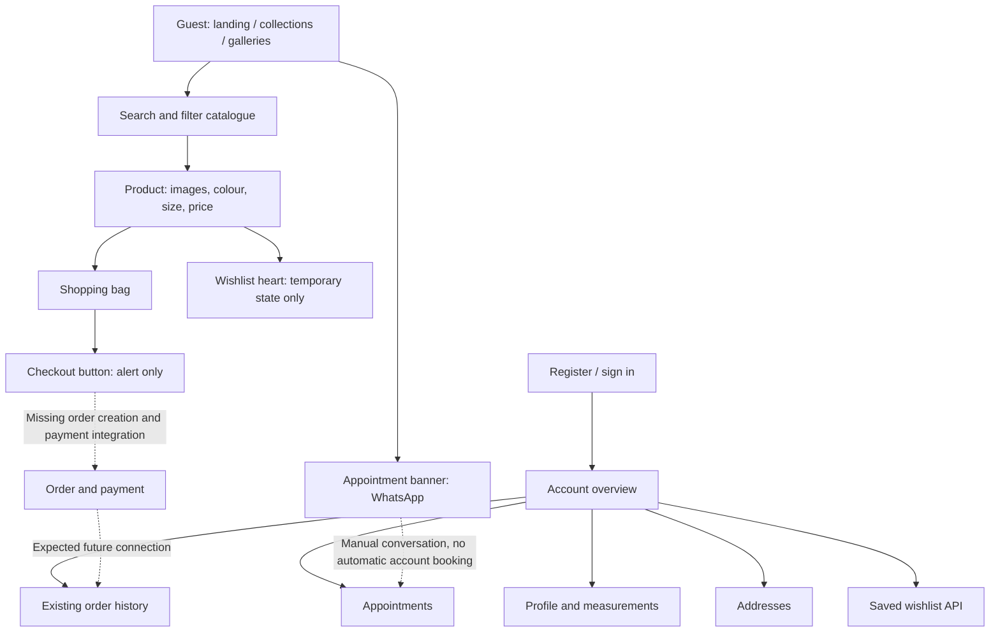

# Buyer workflow and dependency audit

Date: 17 October 2026 (Asia/Kolkata)

Follow-up: implementation changes and current verification are recorded in [Buyer fixes and COD checkout](buyer-fixes-2026-10-17.md). The findings below describe the original audited state.

## Result

The project has **two stored authorization roles: `customer` and `admin`**. The buyer uses `customer`. Guest browsing is an unauthenticated state, not a third stored role. Designers are catalogue records, not an implemented login role. No separate seller, staff, delivery-agent or super-admin role was found.

The buyer flow is **not complete for purchases**. Browsing, product selection and a local shopping bag exist, but checkout does not create an order. Several security and data-consistency defects also need attention.

**23 issues recorded: 2 critical, 12 high, 9 medium.** This count includes incomplete features that currently present a working action to users. It is not a claim that every issue has been exploited on a live database.

The audit covers the current working tree, including the recent uncommitted product and account redesign. Application code was not changed during this audit. Admin business workflows are reserved for the next review; only the customer-to-admin access boundary was checked here.

## Roles and access boundaries

| Actor | Entry points | Intended access | Audit result |
| --- | --- | --- | --- |
| Guest | `/`, `/shop`, `/collections/*`, `/products/*`, `/runway`, `/weddings`, authentication pages | Browse, search, manage a local bag, sign in/register | Browse/search work in sampled checks; several public APIs expose more access than intended |
| Customer / buyer | `/login`, `/register`, `/account/*` | Own profile, measurements, addresses, wishlist, appointments and order history | Main account APIs require a bearer token; ownership defect exists in appointment update |
| Admin | `/admin` and `/api/admin/*` | Administrative operations | Customer token rejected with 403 in isolated role-gate check; full admin review pending |

Sources: `hono/src/db/schema/index.ts:10`, `hono/src/middleware/auth.ts:7`, `hono/src/modules/admin/index.ts:14`, `frontend/src/react/user/components/UserPortalLayout.tsx:11`.

## Buyer workflow

The user panel contains **six sections**: Overview, Orders, Appointments, Wishlist, Profile & measurements, and Addresses.

## Dependent features and modules

These are **16 logical feature areas**, counted for this audit rather than as database roles or backend route-module totals.

| # | Feature area | Main dependencies | Current assessment |
| --- | --- | --- | --- |
| 1 | Authentication and session | Auth pages → `fetchApi` → Next account proxy → auth module → users/reset tokens → scrypt/JWT → persisted auth store | Basic token/password checks pass; reset delivery, reset-token exposure and session revocation need fixes |
| 2 | Catalogue and categories | Local `MENS_PRODUCTS` + catalogue loader → products/categories API → MySQL | Healthy API returns 24 active products; storefront shows 33 after merging local entries; cached data can become stale |
| 3 | Search, filtering and sorting | Header `/api/catalog`, ShopListingView, catalogue/category/size/price data | Sampled text search and mobile category filter work; sale-price and category consistency issues remain |
| 4 | Product details, variants and availability | Product route → normalized catalogue → ProductDetailView → images, sizes, colour variants, stock | Sale price works on detail; aggregate stock is discarded; new product routes require a build |
| 5 | Shopping bag | Product/quick add → Zustand cart store → localStorage → CartPage | Local persistence exists; variant identity, stock ceilings and pricing differ by entry path |
| 6 | Wishlist | Shop heart vs account wishlist API → wishlist items → products → auth | Shop heart is disconnected from saved account wishlist |
| 7 | Checkout and fulfilment choice | Bag → address selection, server pricing, stock validation, orders/order items | Not implemented beyond an alert and placeholder API GET |
| 8 | Payments | Payment API → payments/order state; intended payment-provider dependency | Public write and read routes lack necessary protection; no verified provider checkout |
| 9 | Order history | Account overview/orders → account proxy → orders/order items → auth | List/detail queries are scoped to customer; no buyer order-creation path |
| 10 | Shipping and tracking | Shipping API → shipments/orders → intended order-details integration | Public shipment list; account order details do not show a carrier/tracking link |
| 11 | Personal profile | Auth-store snapshot → ProfileView → users/me | Save path is wired; not live-write tested against existing customers |
| 12 | Measurements | ProfileView → measurements API → user measurements | Unit conversion/save path is wired; not live-write tested against existing customers |
| 13 | Address book | Address dialogs → users/me/addresses → address records → intended checkout dependency | CRUD is wired; affected-row and default-address logic have defects |
| 14 | Appointments | Account dialogs → appointments API → appointment records; public CTA → WhatsApp | Book/reschedule/cancel wired; ownership, false-success and date validation defects |
| 15 | Product media and galleries | Public images, upload endpoint, runway/wedding data and PhotoGallery | Existing gallery implementation present; public upload accepts requests without an access gate |
| 16 | Customer care, policies and communications | Email/phone/WhatsApp links, full Footer, expected email/newsletter services | Contact links exist; full-footer policies and subscription are placeholders; reset email missing |

Buyer-related persisted entities inspected: users, password reset tokens, categories, products, orders, order items, payments, shipments, wishlist items, addresses, user measurements, appointments, media and reviews. There is no persisted cart or completed checkout implementation.

## Findings

Evidence labels: **UI** = observed in the running browser; **HTTP** = safe live request; **isolated** = actual route/store exercised with synthetic data and a mocked database; **source** = implementation traced without mutating live data. Conditional production behavior is identified explicitly.

### B01 — Critical: Payment status can be forged without signing in

- **Dependency:** payments → orders.
- **Evidence:** isolated route test; `hono/src/modules/payments/index.ts:32` and `:49`.
- **Reproduction:** in an isolated fixture, submit a payment record with an existing order ID, amount `1` and status `paid`, with no authorization header. Route returns 201 and updates the order to `processing`. A negative amount is also accepted. No payment provider is contacted.
- **Impact:** an unauthenticated caller can create false financial records and advance another customer's order. Client-supplied amount/status/reference are trusted; no ownership check, provider signature verification or replay protection is present.
- **Fix:** restrict manual recording to authorized administrative operations; use verified provider callbacks for online payments; load expected amount/order state on the server; enforce positive amounts, unique provider references, legal state transitions and a transaction.

### B02 — Critical, environment-dependent: Forgot-password exposes the reset secret

- **Dependency:** public auth → password-reset tokens → account access.
- **Evidence:** isolated route test; `hono/src/modules/auth/index.ts:97`.
- **Reproduction:** with `NODE_ENV` other than `production`, a forgot-password request for a registered fixture email returns its usable `resetToken` directly to the unauthenticated requester.
- **Impact:** anyone who knows a registered email can obtain its reset token if this configuration is reachable. This affects every stored role using this auth endpoint. Exploitation against existing users was not attempted.
- **Fix:** never return a real reset secret in the public response. Deliver it through the account's verified email channel; use an isolated mail sink for development.

### B03 — High: Appointment update discloses another customer's appointment

- **Dependency:** appointments → ownership checks → private notes/location/purpose.
- **Evidence:** isolated route test; `hono/src/modules/appointments/index.ts:114`–`:128`.
- **Reproduction:** customer A sends an update for customer B's appointment ID. The ownership-scoped UPDATE affects zero rows, but the result header object is truthy. The subsequent SELECT filters only by appointment ID and returns B's location, occasion, time and notes.
- **Impact:** authenticated customers can disclose another customer's appointment details. The current panel does not expose this PUT action, but the backend and account proxy accept it.
- **Fix:** establish ownership before mutation, check affectedRows correctly and scope the response query to the authenticated owner. Return 404 for another customer's record.

### B04 — High: Payment history and shipment list are public

- **Dependency:** payments/shipping → customer orders.
- **Evidence:** isolated routes; live HTTP 200 for payment history on an unused ID and for the shipment-list endpoint; `hono/src/modules/payments/index.ts:12`, `hono/src/modules/shipping/index.ts:8`.
- **Reproduction:** no bearer token is needed to fetch payments by an order ID or enumerate shipment records. Synthetic records were returned by the isolated checks.
- **Impact:** payment references, amounts/status and shipment tracking/order identifiers can be disclosed outside the owning account. This finding does not claim that address or card numbers are returned.
- **Fix:** require authentication and order ownership for customer reads; protect global lists by admin role. Any public tracking flow should disclose only intentionally public, narrowly scoped information.

### B05 — High: File upload is public and lacks content/size controls

- **Dependency:** media upload → disk storage → publicly served `/uploads/*`.
- **Evidence:** isolated empty multipart request reaches handler validation with 400 instead of an auth rejection; source `hono/src/modules/media/index.ts:27`–`:59` and `hono/src/app.ts` static upload serving.
- **Reproduction:** upload route has no authentication/role middleware. It uses the supplied extension, reads each file fully into memory and writes it to public storage. No actual files were uploaded during the audit.
- **Impact:** anonymous storage abuse and serving arbitrary file types are possible from this code path. This is not evidence of server-side code execution.
- **Fix:** restrict uploading to an allowed role, validate actual file content against an allowlist, enforce request/file/count limits and store generated safe filenames. Generate URLs from configured deployment origins.

### B06 — High, blocking feature gap: Buyer checkout cannot place an order

- **Dependency:** cart → address/fulfilment → inventory/pricing → orders → payments.
- **Evidence:** source and isolated POST 404; `frontend/src/components/CartPage.tsx:145`, `hono/src/modules/checkout/index.ts:5`, `hono/src/modules/cart/index.ts:5`.
- **Reproduction:** Proceed to checkout only calls a browser alert. Checkout API implements only a placeholder GET. Orders API implements list/detail reads, with no buyer order creation.
- **Impact:** the user can build a bag but cannot complete a purchase. Buy Now also ends at this same bag. Saved addresses, measurements, shipping choice, payments and order history are not connected into a purchase transaction.
- **Fix:** implement the server-authoritative checkout transaction, address/order snapshots, stock reservation, payment initiation/confirmation, error/retry handling and confirmation view. Do not treat the placeholder GET's 200 as a functioning checkout.

### B07 — High: Wishlist heart does not save to the account

- **Dependency:** product listing → wishlist UI → authenticated wishlist API.
- **Evidence:** browser refresh test and source; `frontend/src/components/ShopListingView.tsx:82` and `:461`.
- **Reproduction:** click a product's heart. It becomes pressed. Refresh: it returns to unpressed. The action only changes local component state and never calls the wishlist API.
- **Impact:** the user sees a saved state but the product does not appear in `/account/wishlist`. No authenticated add-to-wishlist caller was found in the storefront.
- **Fix:** use the saved wishlist API/state when signed in; define guest persistence and login migration if guest saving is intended; handle failed saves visibly.

### B08 — High: Different sizes/colours collapse into one cart line

- **Dependency:** product selection → cart line identity → eventual fulfilment.
- **Evidence:** actual cart-store isolated test; `frontend/src/stores/cartStore.ts:22`, `frontend/src/components/ProductDetailView.tsx:116`, `frontend/src/types/index.ts` CartItemDto.
- **Reproduction:** add size 38 and size 40 of the same product. Only one line remains, titled size 38, quantity 2. The first line's price also wins. Colour and size are stored in display text, not structured variant fields.
- **Impact:** quantities can represent the wrong sizes/colours; removing or adjusting one variant affects the merged line.
- **Fix:** add explicit variant/colour/size fields and a variant-aware line key; use that key consistently for add/update/remove and order item snapshots.

### B09 — High: Quick add and detail page charge different prices

- **Dependency:** catalogue → listing/search → cart totals.
- **Evidence:** live API/UI plus source; `frontend/src/components/ShopListingView.tsx:196` and `:525`, `frontend/src/components/ProductDetailView.tsx:73`.
- **Reproduction:** product 8, Embrace Embroidered Velvet Bandhgala, has base ₹1,45,000 and sale ₹1,35,000. Product detail uses ₹1,35,000; listing and quick add use ₹1,45,000. Header search also displays the base price.
- **Impact:** the bag total depends on how the product was added. Price filtering/sorting likewise uses base price rather than effective sale price.
- **Fix:** share a single effective-price rule across listing/search/detail/cart; revalidate the actual payable amount server-side at checkout.

### B10 — High: Stock and cart quantity are not enforced

- **Dependency:** products/inventory → product availability → bag.
- **Evidence:** isolated normalizer/store tests and source; `frontend/src/lib/catalog.ts:15`, `frontend/src/components/ProductDetailView.tsx:75`, `frontend/src/stores/cartStore.ts:39`.
- **Reproduction:** normalize a product with total stock 0 and a nonempty inStockSizes list. The stock field is discarded and the detail purchase condition only checks size membership/price. Cart quantity can be set to 100000 without validation.
- **Impact:** zero-stock or over-stock quantities can be added. Missing stock-size data is also replaced by invented default availability. The placeholder checkout provides no server correction.
- **Fix:** model actual aggregate/variant stock, avoid availability defaults, validate positive integer quantity with stock limits, and re-check/reserve inventory server-side.

### B11 — High: Local fallback is published alongside the healthy database catalogue

- **Dependency:** catalogue loader → products, IDs, wishlist and future orders.
- **Evidence:** HTTP/UI count comparison and isolated empty-catalog check; `frontend/src/lib/catalog.ts:59`–`:81`, `hono/src/modules/products/index.ts:54`.
- **Reproduction:** backend returns 24 active products; storefront shows 33. IDs 117–125 are local-only; backend `/api/products/117` returns 404. Even a successful empty backend catalogue still publishes local products. Database errors are also converted into success/empty data by the products list API.
- **Impact:** users can add products to a local bag that the backend cannot find. A future saved wishlist call for such IDs would fail. Removing/deactivating a product that also exists in local data can leave it visible.
- **Fix:** use a consistent authoritative catalogue/ID source. Make demo/offline fallback explicit and limited to the intended environment; return real service errors instead of concealing them as an empty success.

### B12 — High: Published catalogue changes and new product URLs require rebuilding

- **Dependency:** catalogue cache → server-rendered shop/search/product routes → catalogue maintenance.
- **Evidence:** source; `frontend/src/lib/catalog.ts:62`, `frontend/src/app/products/[id]/page.tsx:8` and `:14`.
- **Reproduction condition:** after a production build, add a product or change price/availability. Fetch uses `force-cache` with no revalidation or invalidation path found. Product routes set `dynamicParams = false`, allowing only IDs collected at build time.
- **Impact:** current changes can remain stale; newly created product URLs can return 404 until a rebuild. This is a source-confirmed production configuration issue, not a production deployment experiment.
- **Fix:** establish on-demand or timed revalidation and allow runtime product resolution as required. Invalidate shop/search/detail content when catalogue data changes.

### B13 — High, incomplete recovery flow: Production password-reset email is never sent

- **Dependency:** forgot password → token delivery → reset page.
- **Evidence:** source and isolated production response; `hono/src/modules/auth/index.ts:97`–`:106`.
- **Reproduction condition:** production forgot-password creates a reset token and says a link was sent, but there is no mail-provider/send operation. The raw-token development shortcut is absent in production.
- **Impact:** a buyer who forgot their password cannot complete recovery through the promised email flow.
- **Fix:** implement token delivery through a configured email provider, with expiry, safe retry handling and neutral account-existence messaging.

### B14 — High: Password reset does not revoke existing sessions

- **Dependency:** reset/change password → JWT verification → all private account modules.
- **Evidence:** isolated reset plus real JWT issue/verify test; `hono/src/modules/auth/index.ts:134`, `hono/src/modules/users/index.ts:63`, `hono/src/lib/auth.ts:41` and `:50`.
- **Reproduction:** issue a JWT, reset the same fixture user's password, then verify the old JWT. It remains valid. Tokens last seven days; verification does not check a session record, token version or password-change timestamp.
- **Impact:** someone holding an old token can retain access after the owner resets the password. Sign out removes local state only and does not revoke a copied token.
- **Fix:** define server-enforced session revocation/token versioning on recovery and sensitive credential changes; invalidate outstanding recovery tokens as appropriate.

### B15 — Medium: No-op mutations return misleading success

- **Dependency:** appointment/address/wishlist mutations → feedback and account state.
- **Evidence:** isolated zero-row update/delete tests; appointments `:86`, `:119`, `:158`; users `:170`, `:183`; wishlist `:92`.
- **Reproduction:** cancel/reschedule an absent appointment, update/delete an absent address, or remove a missing wishlist item. The code checks the truthiness of the MySQL result header, which remains an object when affectedRows is 0.
- **Impact:** the UI may report a completed action even when nothing changed. Appointment general-update can instead crash when its follow-up record is absent; B03 is the more serious ownership consequence.
- **Fix:** distinguish existence/ownership and legal current status; inspect affectedRows where appropriate. For idempotent deletes, define that behavior explicitly rather than using an ineffective not-found check.

### B16 — Medium: Address default updates can clear defaults or create duplicates

- **Dependency:** address update → default delivery/billing address selection.
- **Evidence:** isolated route tests; `hono/src/modules/users/index.ts:158`–`:168`.
- **Reproduction:** updating with `{isDefault:true}` without repeating label does not clear the existing default. Updating a nonexistent/foreign ID with label and isDefault true clears the caller's current defaults before verifying target ownership/existence. The current full form usually supplies label, so the first defect is exposed through the partial API contract.
- **Impact:** the account can have multiple defaults or unexpectedly lose its default. Clearing and writing are not transactional.
- **Fix:** fetch the owned target first, derive its effective label, then clear/set defaults atomically. Define behavior when changing label or deleting a default.

### B17 — Medium: Appointment API accepts past dates

- **Dependency:** appointment validation → scheduled records → overview/upcoming list.
- **Evidence:** isolated creation using year 2000 returns 201; `hono/src/modules/appointments/index.ts:43` and `:148`.
- **Reproduction:** submit a parseable past scheduledAt directly to the create/reschedule API. Only invalid Date is rejected. The frontend rejects past values, but the server does not.
- **Impact:** impossible historical bookings can be stored as upcoming. Server rules can be bypassed by any authenticated API client.
- **Fix:** enforce future date/time on create and reschedule at the API. Separately define working hours, slot capacity and location rules before claiming availability validation.

### B18 — Medium: Existing product category link leads to 404

- **Dependency:** database category name → product breadcrumb → collection route.
- **Evidence:** UI + HTTP; product 29 breadcrumb points to `/collections/bottoms`, which returns 404; `frontend/src/components/ProductDetailView.tsx:82`, `frontend/src/app/collections/[category]/page.tsx:8`.
- **Reproduction:** open Hand-loomed Mulberry Silk Churidar and click Bottoms in its breadcrumb. Database category is Bottoms; frontend route map does not support it.
- **Impact:** navigation breaks and the Trousers collection does not include every relevant bottom garment under the current names.
- **Fix:** use stable category slugs from the authoritative catalogue and align existing Bottoms/Trousers taxonomy. Resolve categories dynamically or maintain validated shared definitions.

### B19 — Medium: Authentication inputs lack associated accessible labels

- **Dependency:** sign in/register/recovery form controls → keyboard/assistive technology.
- **Evidence:** browser DOM on login and auth-page source; login input labels count is 0, with no ID/aria-label; `frontend/src/react/auth/pages/LoginPage.tsx:56` and the corresponding Register/ForgotPassword/ResetPassword forms.
- **Reproduction:** inspect the email/password input's accessible name. The visible label is a sibling without htmlFor and the input has no corresponding ID.
- **Impact:** screen-reader users cannot reliably identify the fields; clicking the visible label does not focus its input.
- **Fix:** associate labels with stable IDs or wrap inputs; add appropriate autocomplete names and connect validation feedback to each field.

### B20 — Medium: Full-footer support and policy navigation is placeholder content

- **Dependency:** customer care → full Footer → policies/help/navigation.
- **Evidence:** source and visible full footer on login; `frontend/src/components/Footer.tsx:90`–`:129`.
- **Reproduction:** click Returns & Exchange, FAQs, gift-card balance or policy links in the full footer. They point to `#`. Some category/contact/gallery anchors are page-relative and have no destination on login/cart/collection pages.
- **Impact:** buyers cannot reach the promised purchase/returns/help information. Compact footer on the landing/shop/account is a different branch and does not contain these controls.
- **Fix:** provide real destinations or remove unsupported actions; use the current `/runway`, `/weddings`, category routes and explicit home anchors where appropriate.

### B21 — Medium: Newsletter subscribe form does not subscribe

- **Dependency:** full Footer form → missing subscription service.
- **Evidence:** source; `frontend/src/components/Footer.tsx:60`.
- **Reproduction:** enter an email into the full-footer form and submit. It has no handler/action integration; input also has no name. Native form submission reloads/navigates the current page rather than saving a subscription.
- **Impact:** a user believes they can subscribe, but their email is not registered. No message/service path exists.
- **Fix:** connect a real subscription endpoint/provider with validation, consent/status feedback and duplicate handling, or remove the inactive form until supported.

### B22 — Medium: Inactive product can still be fetched through the public detail API

- **Dependency:** product visibility → products detail API.
- **Evidence:** isolated route fixture; `hono/src/modules/products/index.ts:60`–`:120`.
- **Reproduction:** product list filters isActive true, but ID/slug/SKU detail lookup has no active predicate. A fixture inactive product returns 200 with its details.
- **Impact:** deactivating a product does not prevent direct public retrieval. This is separate from the frontend local fallback problem in B11. Admin currently also reads this public route for editing, so its use needs a dedicated authorized detail path.
- **Fix:** restrict public detail to active products and provide an admin-authenticated detail endpoint for editing inactive items.

### B23 — Medium: Manual reset-token input disappears after the first character

- **Dependency:** direct reset-page visit → manual recovery token entry.
- **Evidence:** browser reproduction and source; `frontend/src/react/auth/pages/ResetPasswordPage.tsx:60`–`:63`.
- **Reproduction:** visit `/reset-password` without a query-string token. The Reset Token input appears. Type one character: the input is removed because its visibility depends on `!token`, and its own onChange immediately sets token to a nonempty value.
- **Impact:** a user typing a token manually cannot finish or correct it. The normal link with a complete token query parameter follows a different path. No real token/password was entered or changed during this check.
- **Fix:** distinguish a token supplied by the URL from a manually edited token; keep the manual field visible throughout entry and validation.

## Other incomplete dependencies, outside the 23 findings

These features are not treated as new bugs solely because a module/table exists. They are implementation gaps to resolve if part of the intended buyer scope:

- **Change password in account:** backend POST `/users/me/change-password` exists, but no account form uses it and the account proxy allowlist rejects that path with 404. Forgot-password is a separate flow.
- **Shipment tracking in account:** OrdersView shows status and item details but no carrier, tracking number/link or delivery timeline, despite the panel's tracking copy and existing shipping module.
- **Buyer reviews:** approved-review read endpoint and review table exist; no buyer review-submission endpoint/UI was found.
- **Transactional notifications:** no order/appointment confirmation email/SMS integration was found. The public appointment banner opens WhatsApp; that conversation is not automatically saved as an account appointment.
- **Account/cart persistence:** cart exists only in that browser's localStorage; no account-linked cart synchronization, cross-device restoration or explicit guest-to-customer merge flow is implemented.
- **Order snapshots:** current schema has no structured order-line size/colour or order address/fulfilment snapshot. These must be designed as part of real checkout rather than relying on current mutable profile/address/product data.

## Checks and evidence limits

### Completed

- Source review of buyer routes, account views, auth/cart stores, API helpers/proxy, catalogue normalization, validation, relevant schema and buyer-facing backend modules.
- Existing backend tests: **16/16 passed** (password hashing, JWT basics and auth middleware).
- Isolated diagnostic suite: **29/29 scenarios matched the observed implementation**, including defect reproductions and five authentication/role-boundary checks. Passing diagnostics mean the reported current behavior was reproduced, not that those bugs are fixed.
- Frontend TypeScript check passed.
- Backend build passed.
- Safe HTTP: frontend/backend health 200; unauthenticated orders, appointments, wishlist and users/me return 401; change-password proxy path 404; local-only product API 404; Bottoms collection 404; payment-history/shipment routes reachable without auth.
- Browser: wishlist state disappears after refresh; search finds the sampled product; anonymous account visit redirects to login; category filter narrows to five Kurtas; mobile login/shop have no horizontal overflow in sampled 390×844 checks; detail sale price and Bottoms breadcrumb verified; manual reset-token field disappears after typing one synthetic character.

### Not performed / not claimed

- No payment, real order, customer password change, customer registration, booking, address/profile write or upload was performed against the configured remote database. Synthetic fixtures replaced the DB for mutation and cross-customer tests.
- No live mail/SMS/WhatsApp message was sent.
- Authenticated browser CRUD against a dedicated real test customer was not performed; no supplied test credentials or isolated test database were available. Normal save wiring was reviewed, while mutation edge cases were executed with fixtures.
- No production rebuild/deployment or after-build catalogue mutation experiment was performed; B12 is established from the current caching/route configuration.
- No exhaustive visual/accessibility or browser matrix, load test, payment-provider sandbox, or concurrency transaction test was run.
- Admin business flows were not audited in this phase.

Audit-only reproduction files are ignored scratch artifacts in `hono/scratch/buyer-audit.test.ts` and `hono/scratch/buyer-audit.config.ts`. They deliberately mock the DB before importing route modules. They must not be repurposed to send mutation tests to a live customer database.

## Recommended fix order

1. **Close unauthorized access first:** B01–B05; stop exposing reset tokens and unauthenticated financial writes/reads, fix appointment ownership, protect uploads.
2. **Make catalogue/cart reliable:** B07–B12, B18 and B22; align IDs, variant keys, effective pricing, stock, visibility, caching and category navigation.
3. **Implement the buyer purchase transaction:** B06 with address/variant snapshots, server totals, stock reservation, verified payment completion, shipping and order confirmation.
4. **Finish account recovery/data correctness:** B13–B17, including session revocation and atomic default addresses.
5. **Finish usable support flows:** B19–B21, B23 and the intended optional modules above.
6. **Then audit admin workflows and shared dependencies**, using the corrected buyer-side contracts as the baseline.
